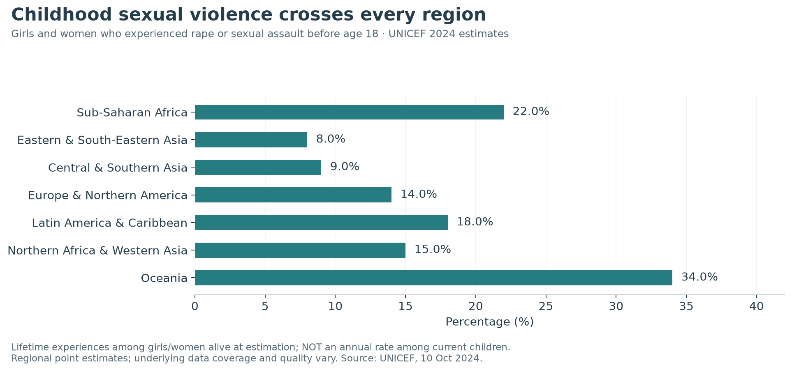
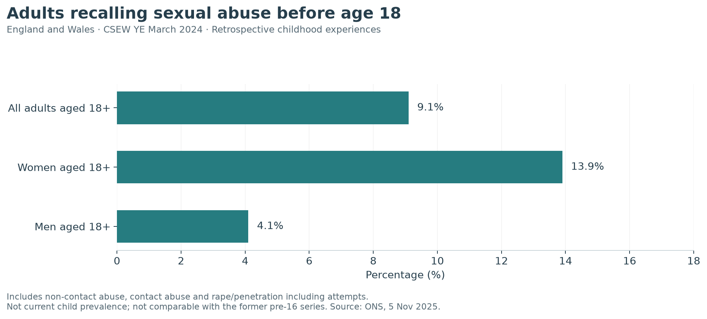

## Worldwide childhood experiences

UNICEF estimates that **more than 370 million girls and women alive in 2024**, approximately **one in eight**, experienced rape or sexual assault before age 18. For boys and men, the estimate is **240–310 million**, approximately **one in eleven**. These totals include adults recalling childhood and children already affected. They are not the number of children assaulted in one year. [UNICEF global release][unicef].

{fig-alt="UNICEF regional prevalence estimates of rape or sexual assault before age 18 among girls and women."}

The most extensive underlying coverage concerns contact sexual violence against girls and women, using surveys from 2010–2022 in 120 countries and areas. Estimates for boys and men and for non-contact violence use a broader evidence base and some indirect methods. Their precision should not be assumed identical.

When non-contact forms are included, UNICEF's global totals rise to **650 million girls and women** and **410–530 million boys and men**. These are broader, overlapping totals; do not add them to the contact figures. Regional rates shown above are point estimates, with no uncertainty intervals provided in this extracted release.

[Download UNICEF regional estimates](data/unicef-childhood-regions.csv).

## England and Wales: adults looking back

The redesigned CSEW childhood questions estimate that **9.1% of adults aged 18 and over**, around **4.3 million people**, experienced sexual abuse before age 18. The figures are **13.9% for women** and **4.1% for men**. The sexual-abuse measure includes non-contact abuse, contact abuse, and rape or assault by penetration including attempts. [ONS childhood bulletin, YE March 2024][ons-child].

{fig-alt="ONS estimates of sexual abuse experienced before age 18, among adults living in England and Wales at the time of the survey."}

These are experiences across many past years, reported by the adult household population at interview. They do not directly measure abuse among children living in England and Wales today, or establish that all recalled abuse occurred within that territory. The newer pre-18 questions and covered population also prevent a trend comparison with the former pre-16 statistics.

Most victims knew a perpetrator. Respondents could report multiple perpetrators and overlapping categories. The fact that 69.8% reported an adult perpetrator and 40.1% an under-18 perpetrator does not imply a total above 100% is an error: some experienced both.

[Download the childhood prevalence estimates](data/england-wales-childhood-2024.csv).

## Why the UK figure cannot be ranked against UNICEF's

| Feature | UNICEF headline | ONS childhood headline |
|---|---|---|
| Population | Girls/women or boys/men alive at estimation | Adults aged 18+ in households in England and Wales |
| Exposure period | Before age 18 | Before age 18 |
| Headline definition | Rape or sexual assault | Broader sexual abuse, including non-contact experiences |
| Evidence | Multi-country estimates from varied sources | Retrospective national household survey |
| Is it annual prevalence among current children? | No | No |

Sharing a childhood age boundary does not make the denominators and definitions identical. The report presents these series in separate charts rather than calculating a UK-to-world ratio.

## England: what children's services identify

The Department for Education records **29,560 children assessed as affected by sexual abuse** and **12,120 assessed as affected by sexual exploitation** in the year ending 31 March 2025. It also reports **2,190 children starting a child protection plan** with sexual abuse as the initial category. [DfE statistical release][dfe].

These are different service measures. Sexual abuse and exploitation can overlap, and not every child assessed as affected enters a protection plan with that primary category. Counts cannot be added or arranged into a simple funnel. The release warns that differences in local recording affect comparisons; the data do not estimate prevalence nationally or locally.

Changing identification, referrals or recording can change the counts without an equivalent change in underlying abuse. Read them as evidence of service contact and recorded need.

The adult/older-adolescent chapter includes ages 16–17, and WHO includes ages 15–17. Those age bands overlap childhood; **never add the adult and childhood headlines together**.


