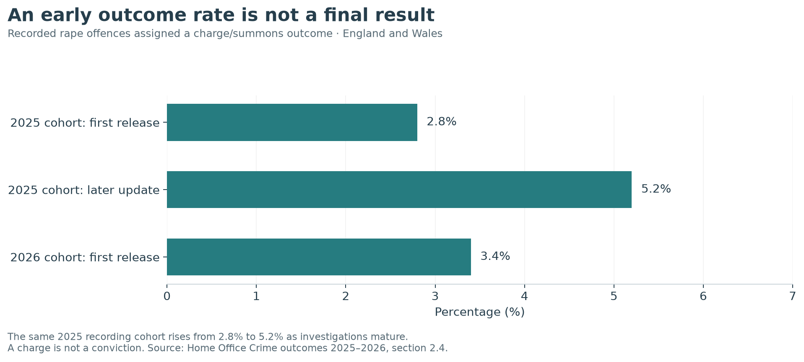

## What reaches the police

Population surveys ask about experiences whether or not they were reported. Police data describe incidents brought to official attention and recorded within the relevant rules. The former can reveal hidden victimisation; the latter is important for understanding investigative demand. One cannot substitute for the other.

Changes in law, recording practices and disclosure influence police trends. The ONS 2025 detailed release notes that two offences introduced by the Online Safety Act account for over half the increase in the broad sexual-offence count that year. A change in the broad category is not automatically a change in contact assault. [ONS prevalence and trends][ons-trends].

For a subset of reporting forces, 20% of sexual offences recorded in YE March 2025 related to incidents more than 12 months earlier. This is a selected-force statistic, not a complete UK figure, and illustrates why recording year differs from occurrence year.

## An early charge rate is not final

The Home Office reports that **3.4% of rape offences recorded in YE March 2026** had a charge/summons outcome in its first annual release. It expects this proportion to rise as investigations conclude. The previous year's cohort demonstrates why: its rate rose from **2.8% when first published to 5.2% in the later update**. [Home Office 2025–2026 outcomes, section 2.4][home-office].

{fig-alt="The initial and subsequently updated charge/summons rate for the 2025 recorded rape cohort, compared with the initial rate for 2026."}

The later 2025 figure is still a snapshot, not a guaranteed final outcome. Comparing the updated 2025 rate directly with the first-release 2026 rate would give investigations different follow-up times. A charge/summons outcome is also distinct from prosecution, conviction and sentence.

For rape offences receiving charge/summons outcomes, the source reports a **median 438 days** from recording to outcome. This is conditional on that outcome group: it is not a waiting time for every survivor or every investigation. Across sexual offences, **26.3% remained without an assigned outcome at year end**. [Home Office outcomes][home-office].

[Download the outcome-maturity figures](data/rape-outcome-maturity.csv).

## Why there is no single conviction funnel here

An experience measured in a household survey, an offence recorded by police and a defendant convicted by a court are different units. They also occur in different periods. Dividing convictions in a year by survey-estimated victims or offences recorded in that same year does not measure the chance of an assault ending in conviction.

A defensible progression analysis needs linked cohorts, consistent offence scope and sufficient follow-up. This edition does not have those linked records, so it does not invent a population-to-conviction percentage.

## Reading relationship statistics carefully

The 2025 ONS release gives victim–perpetrator relationships from **24 police forces**. Among female rape victims with a recorded relationship, an intimate partner was the most common category, at **48%**. Among male rape victims, acquaintance and other family relative were prominent categories. These are selected police records, not a survey of all survivors and not a description of every UK offence. [ONS victim characteristics][ons-victims].

They underline an important boundary of the international chapter: WHO's non-partner comparison excludes intimate-partner sexual violence and cannot describe the whole burden of sexual assault.


