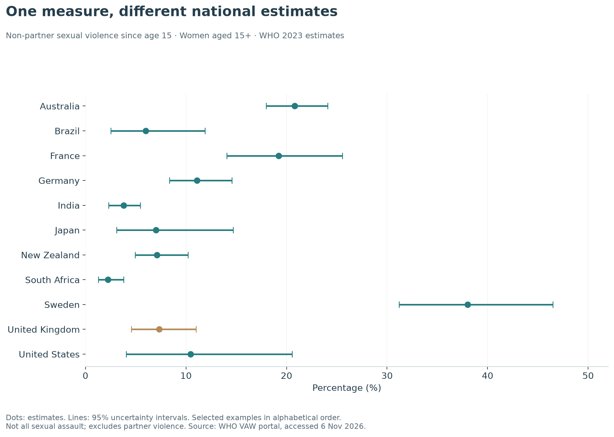
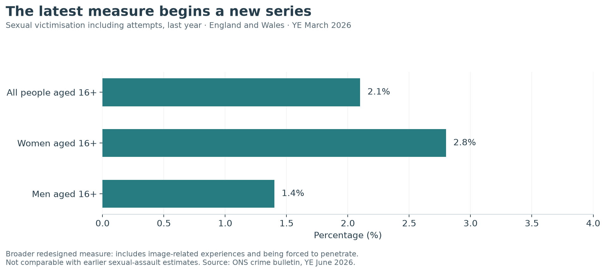
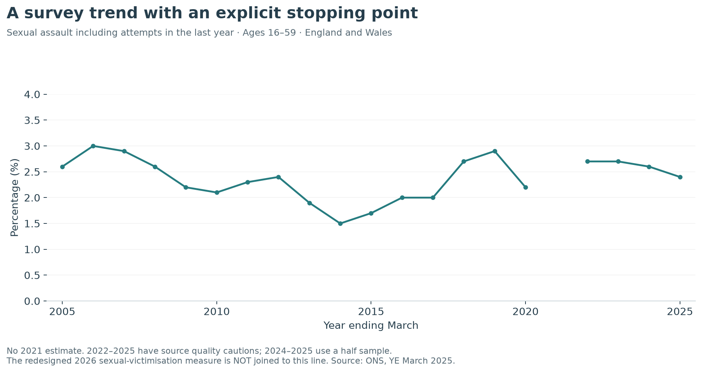
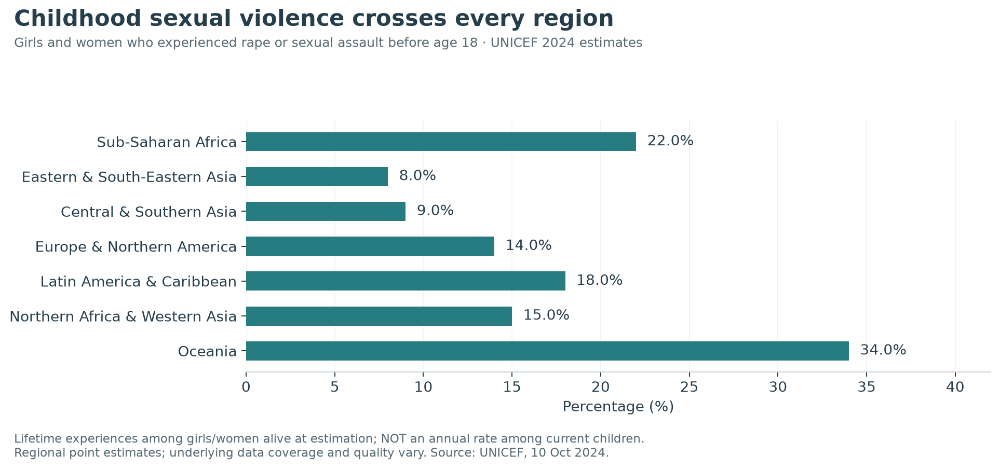
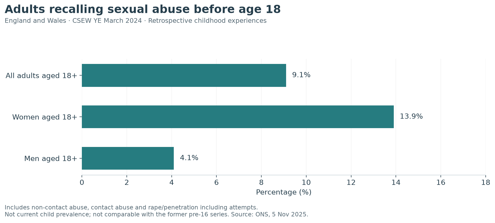
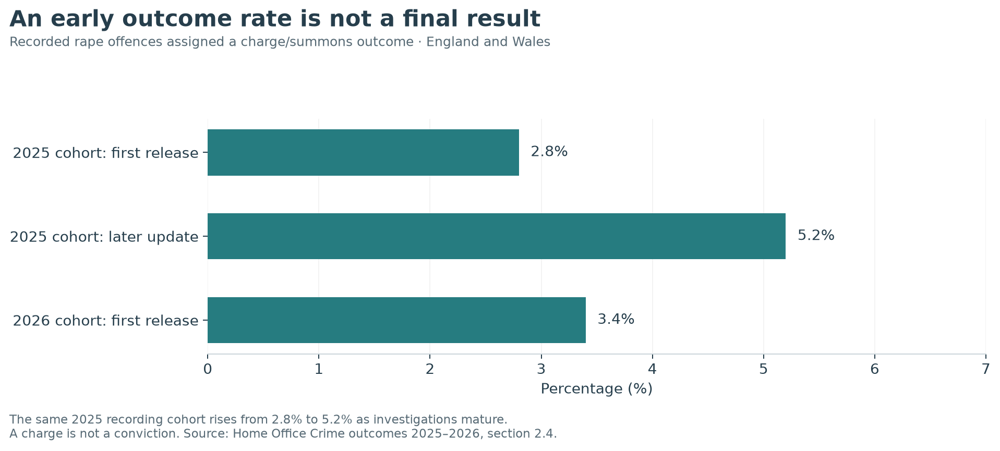

Worldwide sexual-assault comparisons often begin with a country ranking. A more useful starting point is the question behind the number: are we looking at people's experiences, offences recorded by police, or cases reaching a justice outcome?

These sources reveal different parts of a serious problem. They should be read together without being treated as interchangeable.

This article presents the main findings from my [full report, Sexual violence in perspective](FULL_REPORT_LINK), with adult and older-adolescent evidence separated from childhood experiences. The full version includes searchable country tables, downloadable data and detailed source notes. Evidence was checked on 6 November 2026.

## A worldwide comparison with a defined scope

WHO's 2023 estimates draw on studies and surveys conducted between 2000 and 2023. Its harmonised non-partner sexual-violence measure concerns women aged 15 and over who experienced violence since age 15. It excludes a current or former intimate partner, and includes older adolescents within its age band.

The downloaded portal snapshot contains estimates for 138 countries and areas. The UK estimate is **7.3%, with a 95% uncertainty interval of 4.6%–11.0%**. This is an estimate labelled United Kingdom, rather than an England and Wales survey statistic. [WHO data and definitions](https://vaw-data.srhr.org/additional-information).

{fig-alt="WHO estimates of non-partner sexual violence since age 15 among women aged 15+, for selected countries, with uncertainty intervals."}

*Figure 1. Selected WHO 2023 estimates, presented alphabetically. The UK is highlighted; lines show 95% uncertainty intervals. Source: WHO VAW portal, accessed 6 November 2026.*

These are lifetime experiences since age 15, not annual rates. A recent estimation year also does not mean every country supplied a recent survey. WHO's UK inputs in the portal include surveys from 2007 and 2012.

A further distinction matters: the familiar WHO headline of around one in three women combines **physical and/or sexual partner violence and non-partner sexual violence**. It is not a sexual-assault-only rate. [WHO global release](https://www.who.int/news/item/19-11-2025-lifetime-toll--840-million-women-faced-partner-or-sexual-violence).

## England and Wales now has a redesigned measure

The Crime Survey for England and Wales estimates that **2.1% of people aged 16 and over**, around **one million people**, experienced sexual victimisation including attempts in the year ending March 2026. The estimates are 2.8% for women and 1.4% for men.

This redesigned measure includes rape or penetration, being forced to penetrate, unwanted touching, exposure and image-related experiences. ONS states that it is **not comparable with previously published measures**. [ONS latest crime bulletin](https://www.ons.gov.uk/peoplepopulationandcommunity/crimeandjustice/bulletins/crimeinenglandandwales/yearendingjune2026).

{fig-alt="Redesigned sexual-victimisation prevalence among people aged 16+, women and men, England and Wales, year ending March 2026."}

*Figure 2. A new sexual-victimisation series, including experiences beyond contact assault. Source: ONS; CSEW year ending March 2026. Do not calculate a change from the former measure.*

## The earlier trend has its own boundary

The former sexual-assault measure can be followed using a consistent age range of 16–59. Its 2025 estimate was **2.4%**, significantly higher than 1.7% in 2015. The change from 2.6% in 2024 was not statistically significant. [ONS prevalence and trends](https://www.ons.gov.uk/peoplepopulationandcommunity/crimeandjustice/articles/sexualoffencesprevalenceandtrendsenglandandwales/yearendingmarch2025).

{fig-alt="Former sexual-assault prevalence series for ages 16–59, with an explicit gap for 2021 and a stopping point in 2025."}

*Figure 3. Last-year sexual assault including attempts, England and Wales. Source: ONS. No estimate for 2021; source quality cautions apply in 2022–2025. The 2026 redesign is not joined to this line.*

The detailed 2025 release also shows higher prevalence among younger people. It uses the earlier definition and cannot be treated as a breakdown of the redesigned 2026 figure. Age, sex and disability patterns in the full report describe associations, not causes.

## Childhood experiences need a separate account

UNICEF estimates that **more than 370 million girls and women alive in 2024**, around one in eight, experienced rape or sexual assault before age 18. Its corresponding estimate for boys and men is **240–310 million**, around one in eleven. These totals include adults recalling childhood; they are not annual counts among today's children. [UNICEF global estimates](https://www.unicef.org/press-releases/over-370-million-girls-and-women-globally-subjected-rape-or-sexual-assault-children).

{fig-alt="UNICEF regional estimates for girls and women who experienced rape or sexual assault before age 18."}

*Figure 4. Regional childhood-experience estimates among girls and women, UNICEF 2024. These are lifetime experiences, not annual rates among current children. Underlying coverage varies.*

In England and Wales, the redesigned childhood survey estimates that **9.1% of adults aged 18 and over**, around **4.3 million people**, experienced sexual abuse before age 18. The estimates are 13.9% for women and 4.1% for men. This broader category includes non-contact abuse. [ONS childhood bulletin](https://www.ons.gov.uk/peoplepopulationandcommunity/crimeandjustice/bulletins/abuseduringchildhoodinenglandandwales/march2024).

{fig-alt="Adults in England and Wales reporting sexual abuse before age 18, including non-contact abuse."}

*Figure 5. Retrospective childhood sexual abuse among adults, CSEW year ending March 2024. Source: ONS. The newer population and pre-18 questions prevent comparison with the former pre-16 series.*

The UNICEF and ONS headlines have different definitions and populations. Dividing one by the other would not establish how the UK ranks. Their age bands also overlap the adult-oriented sources, so the figures must not be added together.

England's children's services recorded 29,560 children assessed as affected by sexual abuse and 12,120 assessed as affected by exploitation in the year ending March 2025. These can overlap, and service identification is not national prevalence. [Department for Education](https://explore-education-statistics.service.gov.uk/find-statistics/children-in-need-a-focus-on-sexual-abuse-and-exploitation/2025).

## Justice figures change as investigations conclude

The Home Office initially reported charge/summons outcomes for **3.4% of rape offences recorded in the year ending March 2026**. For the previous year's recording cohort, the rate rose from **2.8% at first release to 5.2% in the later update** as more investigations concluded. [Home Office outcomes](https://www.gov.uk/government/statistics/crime-outcomes-in-england-and-wales-2025-to-2026/crime-outcomes-in-england-and-wales-2025-to-2026).

{fig-alt="Initial and updated rape charge/summons rates illustrating how outcome cohorts mature."}

*Figure 6. England and Wales rape outcomes. The 2025 figures describe the same recording cohort at two snapshots. A charge is not a conviction; the updated figure is not necessarily final. Source: Home Office, section 2.4.*

Comparing an updated cohort with a newly recorded one gives cases unequal time to reach an outcome. Dividing convictions in one year by survey-estimated survivors in that year would introduce further mismatches in unit and timing.

## What makes a useful comparison?

A defensible comparison names the population, geography, period and definition. It keeps surveys separate from police records and recognises that more recorded offences can reflect changes in disclosure and recording as well as victimisation.

The full report also explores UNODC recorded-offence rates and the separate systems of England and Wales, Scotland and Northern Ireland. It treats missing returns as missing, rather than zero, and presents uncertainty where supplied.

[Explore the complete report and sources](FULL_REPORT_LINK).

Independent analysis by Kathryn Hopkins. This article discusses sexual violence without graphic descriptions. [NHS support information](https://www.nhs.uk/live-well/sexual-health/help-after-rape-and-sexual-assault/) is available for readers who want it.
