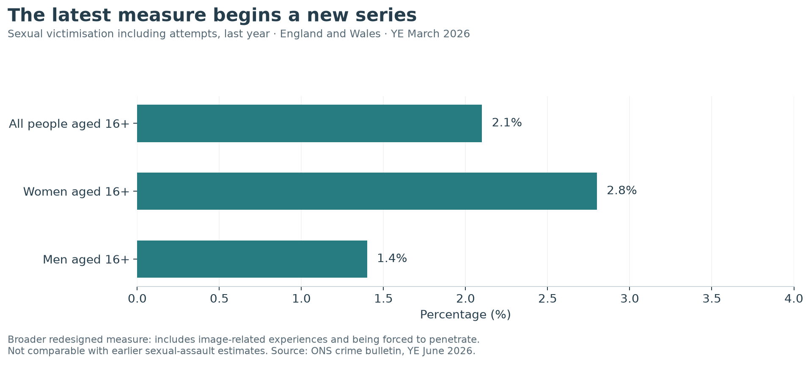
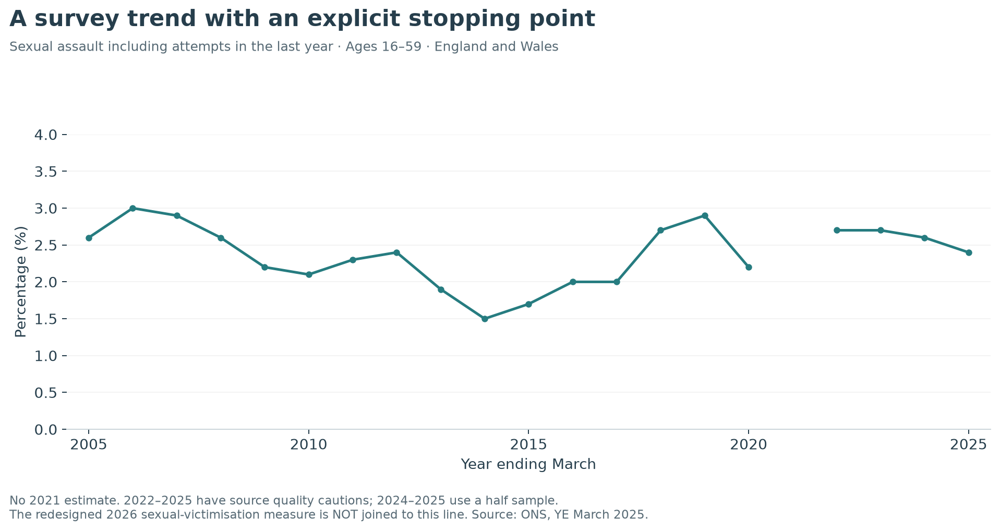
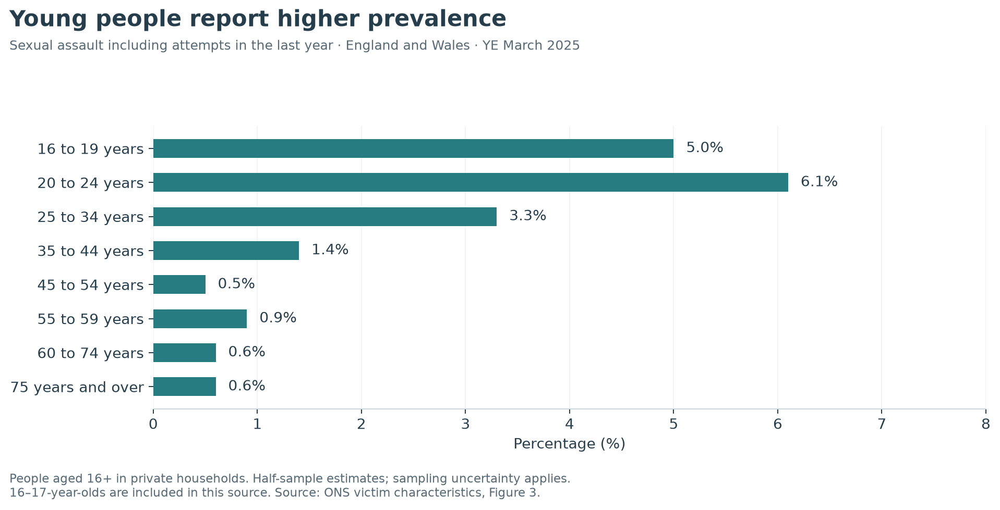

## The latest England and Wales measure

The CSEW estimates **2.1% of people aged 16 and over**, around **one million people**, experienced sexual victimisation including attempts in the year ending March 2026. The estimates are **2.8% for women** and **1.4% for men**. The redesigned questions include rape or penetration, being forced to penetrate, unwanted touching, exposure and image-related experiences. This is a broader label than contact sexual assault. [ONS YE June 2026 bulletin, sexual victimisation section][ons-2026].

{fig-alt="Latest redesigned CSEW sexual-victimisation estimates, shown separately for all people, women and men aged 16 and over."}

**No year-on-year change is calculated here.** ONS explicitly states these redesigned estimates are not comparable with previously published measures. A difference from 2025 cannot be interpreted as a measured increase or decrease.

[Download the latest estimates](data/england-wales-sexual-victimisation-2026.csv).

## The historical sexual-assault series

To examine the former measure over time, use a consistent **16–59 age band**. The 2025 estimate is **2.4%**, compared with **1.7% in 2015**. ONS identifies that decade difference as statistically significant; the change from **2.6% in 2024** is not significant. These are last-year experiences, not lifetime prevalence. [ONS prevalence and trends][ons-trends].

{fig-alt="Sexual assault including attempts in the last year among people aged 16–59, ending in 2025 with a gap for 2021."}

Survey suspension leaves no 2021 estimate. The source cautions about reduced data collection or sample quality in 2022 and 2023 and half samples in 2024 and 2025. The chart shows point estimates, not confidence bands; it supports only the significance statements made in the source.

[Download the historical series](data/england-wales-survey-trend.csv).

## Which groups reported higher prevalence?

The detailed **2025** release uses the former sexual-assault measure. Its all-age estimate is **1.9% among people aged 16+**; it differs from the 2.4% trend value because the age denominators differ. These 2025 breakdowns should not be treated as breakdowns of the redesigned 2026 estimate.

{fig-alt="Sexual-assault prevalence by age in England and Wales, year ending March 2025."}

Reported prevalence was higher among people aged 16–34 than among older groups. Full-time students also reported higher prevalence than other occupational groups; ONS notes that this is likely to be linked partly to age. This is a descriptive association, not proof that being a student causes victimisation. [ONS victim characteristics][ons-victims].

The same release reports greater prevalence among disabled people than non-disabled people. It does not establish the direction of causation. For regional comparisons, survey differences were not statistically significant; police-recorded regional differences can also reflect reporting and recording practices. Individual risk cannot be inferred from a regional average.

[Download the age breakdown](data/england-wales-age-2025.csv).

## Separate national systems

The following are **counts of recorded sexual offences**, covering adults and children, rather than survey estimates. They use each source's categories. The latest selected England and Wales quarter differs from the financial-year Scottish and Northern Irish snapshots; no UK total or ranking is calculated.

| Jurisdiction | Selected period | Recorded count | Official source |
|---|---|---:|---|
| England and Wales | Year ending June 2026 | 218,994 | [ONS crime bulletin][ons-2026] |
| Scotland | 2025–26 | 16,430 | [Scottish Government][scotland] |
| Northern Ireland | 2025–26 | 4,459 | [PSNI financial-year tables, Table 1][psni] |

Scotland's recorded category rose from 14,892 to 16,430 over the year; sexual assault within it rose from 5,124 to 5,222. The national broad-category rate was **30 per 10,000 population**. Scotland's legal categories and counting practices need their own context; these figures are not automatically comparable with other jurisdictions' sexual-assault counts.

Northern Ireland's Table 1 shows 4,279 to 4,459 recorded sexual offences, including 1,267 recorded rape offences in 2025–26. PSNI publishes later rolling updates; the financial-year snapshot is retained here for a clear period and table reference.

[Download the jurisdiction snapshots](data/uk-jurisdiction-snapshots.csv). For an international common-year view with the jurisdictions explicitly separated, see [Worldwide](worldwide.qmd).


