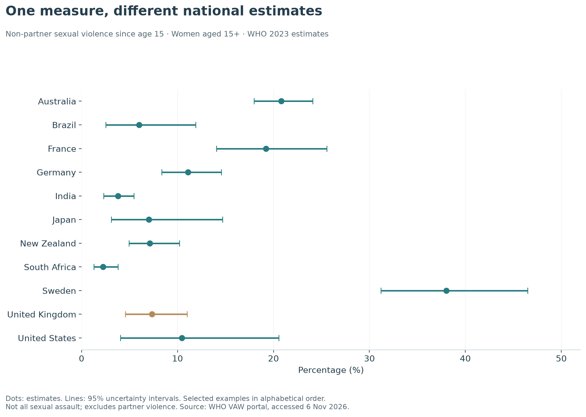
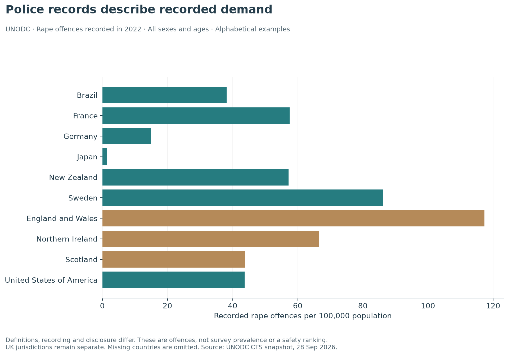

## Comparing experiences across countries

WHO's 2023 estimation round draws on surveys and studies collected between 2000 and 2023. Its **non-partner sexual violence** measure concerns experiences since age 15 among women aged 15 and over. It excludes current and former intimate partners; that omission is part of the definition, not evidence that partner sexual violence is unimportant. The age band includes girls aged 15–17. [WHO publication][who] · [Definitions][who-definitions].

The snapshot contains usable estimates for **138 countries and areas**. The portal's location filter marks 145 as supported, but seven were not returned with estimates by this request. Coverage is reported from the actual response; absent territories are not assigned zero.

{fig-alt="Selected WHO country estimates of non-partner sexual violence, with 95% uncertainty intervals. The United Kingdom is highlighted."}

The UK estimate is **7.3% (4.6%–11.0%)**. Examples range widely, but the chart is not a league table: countries appear alphabetically, and uncertainty is displayed. Model adjustments improve comparability without eliminating differences in disclosure, questionnaires and data quality. The underlying UK inputs in this portal include a 2007 survey and a 2012 survey, both published in 2014; a 2023 model label does not mean a new UK survey was conducted that year. [Underlying-study download](data/who-underlying-studies.csv).

**What does “lifetime” mean here?** Since age 15, not since birth. It is not an annual rate and should not be compared numerically with the England and Wales last-year measure.

### Country explorer

Search all returned countries. Estimates are shown to one decimal place for reading; the CSV retains the supplied precision after conversion from proportions to percentages. The portal fields `lci_lifetime` and `uci_lifetime` supply the interval endpoints.



[Download the full WHO country estimates](data/who-non-partner-sexual-violence.csv).

## Partner violence is a separate measurement problem

The often-cited WHO global headline of around one in three women combines **physical and/or sexual intimate-partner violence and non-partner sexual violence**. It is not an estimate that one in three women has been sexually assaulted. A physical-or-sexual indicator cannot isolate sexual violence by itself. [WHO global release][who-news].

The harmonised country comparison above intentionally uses the sexual-violence-specific non-partner indicator. The report does not add it to physical-or-sexual partner violence: populations and denominators differ, and experiences can overlap.

## What police-recorded international rates measure

UNODC's Crime Trends Survey workbook contains national returns for recorded violent and sexual offences. We extract **offence rates per 100,000 population**, total sex and total age, for rape, sexual assault and the broader sexual-violence category. These remain administrative records. [UNODC data and workbook][unodc].

{fig-alt="Recorded rape offences per 100,000 population in selected jurisdictions in 2022. Countries are alphabetical, with the UK jurisdictions separate."}

The common-year illustration uses **2022** because the England and Wales return for these categories stops there in this workbook. Scotland and Northern Ireland have later returns, while some other countries reach 2024. Selecting each country's latest year would mix periods. All available years remain accessible below.

Higher recorded rates can reflect a combination of higher victimisation, broader definitions, greater willingness to report and more complete recording. Lower recorded rates cannot establish greater safety. The number counts offences rather than unique survivors; recording dates need not be incident dates.

### Recorded-offence explorer

The controls initially show rape in 2022. Change year or category to inspect other returns. **A missing row is unavailable data, not zero.** Do not sum broad sexual violence with its rape and sexual-assault subcategories.



[Download all extracted UNODC rates](data/unodc-recorded-rates.csv) · [Download the plotted common-year selection](data/unodc-2022-comparison.csv).

The displayed WHO and UNODC rates should never be divided by one another to estimate reporting. They differ in population, period, definition and unit.


